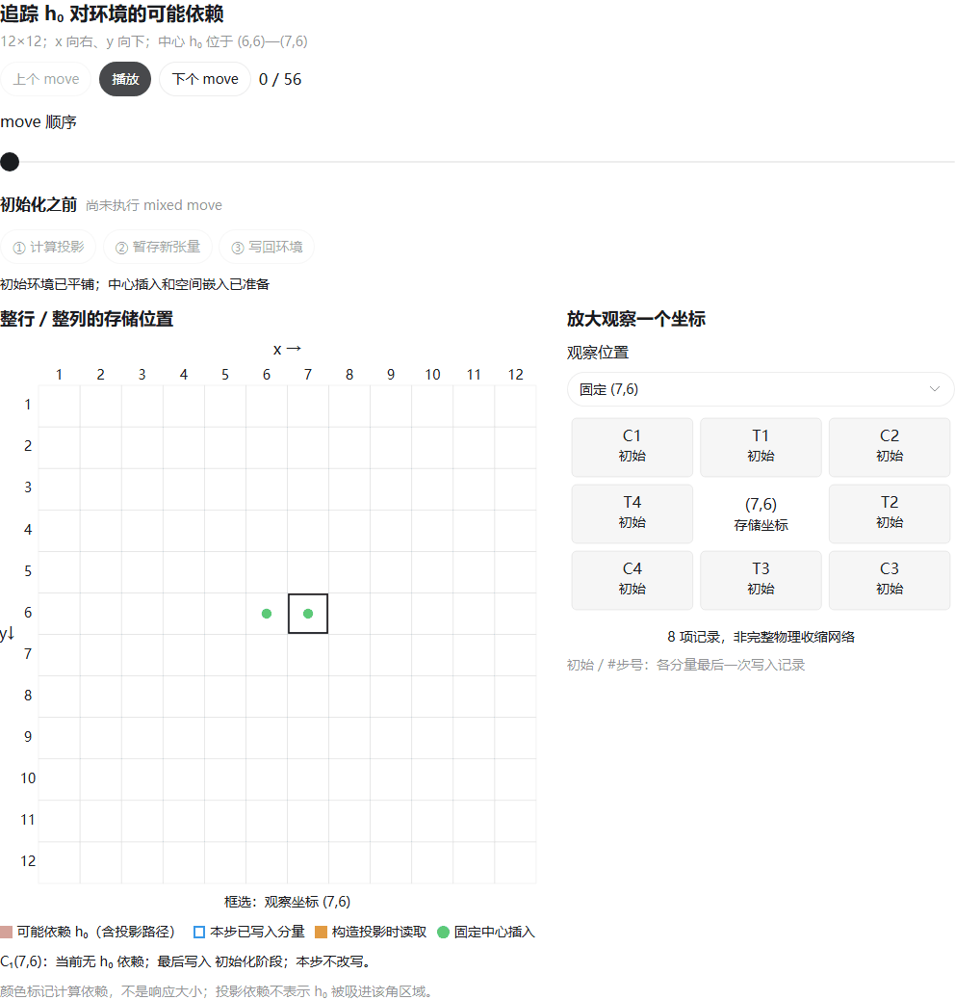
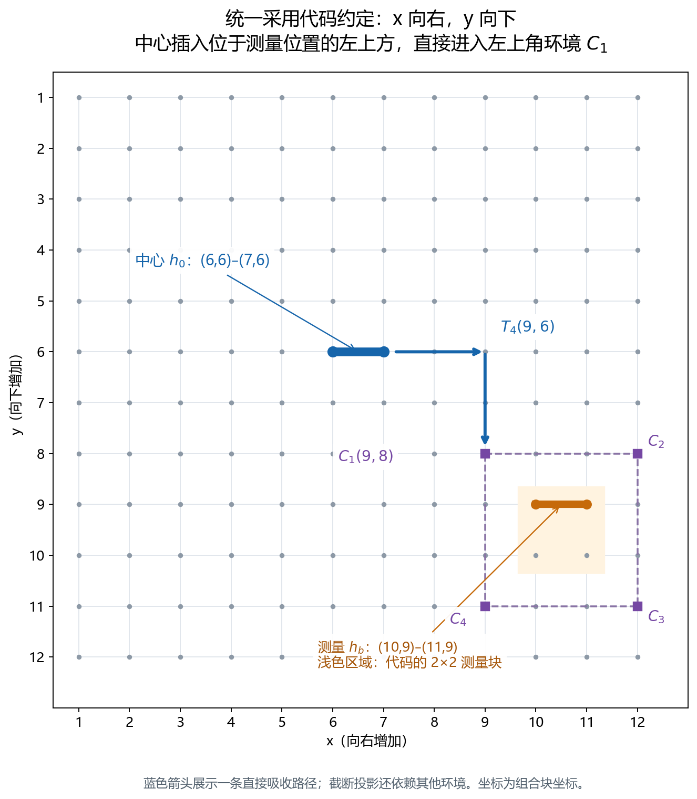
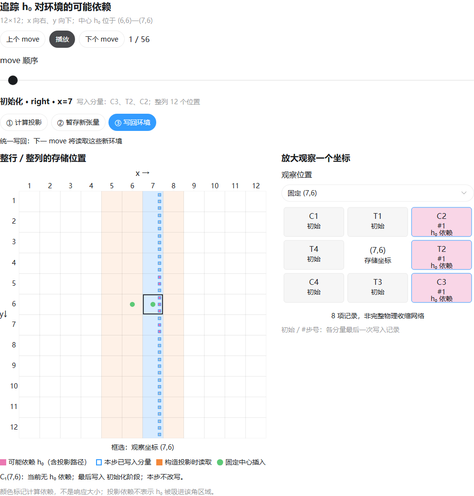

# Kagome LC-CTMRG：逐步动画与算法说明

这些材料解释本仓库当前的能量方差实现，便于逐帧核对环境更新。
它们不是论文作者提供的代码，也不构成完整数值正确性验证。

## 如何观看

下载或克隆仓库后，用浏览器直接打开：

- [h₀ 依赖标记版（推荐）](ctmrg_h0_influence_interactive.html)：暂停、播放、逐步前进，并切换投影/待写回/写回阶段。
- [环境读写版](ctmrg_moves_interactive.html)：查看每个 move 的读取位置、写入位置及此前更新记录。

两个网页均可离线播放，无须 Python、Julia、网络或 Codex。
GitHub 文件预览不会执行交互网页，需将 HTML 下载后打开。

GIF 便于快速查看；网页更适合停在某一步分析：

[普通环境读写 GIF](animations/ctmrg_moves_56.gif)

## 固定坐标与示例

x 向右，y 向下；C1/C2/C3/C4 分别为左上/右上/右下/左下，
T1/T2/T3/T4 分别为上/右/下/左。所有坐标从 1 开始。

示例网格 N=12，源双层张量位于 (6,6)、(7,6)。
动画固定使用当前实现的水平源示例；它不自动演示所有 kagome 对角线源。

## 当前代码的实际顺序

预备：right x=7，然后 bottom y=6。

每一轮按以下顺序执行，重复两轮，预备步骤不重复：

| 阶段 | move 坐标 | 写入的环境 |
|---|---|---|
| left | x=5,6,…,11 | C1、T4、C4 |
| right | x=8,7,…,2 | C2、T2、C3 |
| top | y=5,6,…,11 | C1、T1、C2 |
| bottom | y=7,6,…,2 | C4、T3、C3 |

水平 move 处理整列所有 y，竖直 move 处理整行所有 x。
同一次 move 先从同一份旧环境计算全部投影器和待更新张量，再统一写回。
后一个 move 读取前一个 move 写回的环境；四个方向不是彼此独立的计算。

更完整的存储结构、投影器构造、读写坐标和测量伪代码见
[算法伪代码](LC_CTMRG_algorithm_pseudocode.txt)。

## 颜色意味着什么

- 粉色填充：该环境在计算表达式上可能依赖 h₀，包括通过截断投影器产生的间接依赖。
- 蓝色边框：本次 move 写入的位置。
- 橙色：本次读取的环境；绿色：中心源。

“可能依赖”不等于数值响应必然非零，也不表示其大小。
尤其不能把它解读为 h₀ 已进入该 corner 所代表的真实空间区域。
压缩后的角张量依赖环境选取的边界基底，因此可能通过投影器依赖区域外的源。
第一步只有中心附近少数环境带 h₀ 依赖标记，并非整列都受到影响。

## 与论文的区别和验证范围

参考：Cortés Estay、Kamar、Corboz，PRB 113, 245114 (2026)，
[第 II.3 节](https://arxiv.org/html/2511.22669v2#S2.SS3)。

论文的水平源示例仅先做一次 right(x=m+1) 预备更新，然后进行四方向扫描；
竖直源将整套流程旋转 90°。当前实现无条件先做 right(xmax) 和 bottom(ymax)。
额外的 bottom 预备更新不是论文明确要求的步骤，其必要性和精度影响尚未单独验证。
本次整理保留数值代码和动画原有顺序，没有悄悄删除或更换这一步。

kagome 的下三角形包含在方格网络上呈对角线的物理最近邻 bond。
当前实现通过两段虚拟路径传递算符辅助指标，修改两端及中间三角形张量。
这种源的扫描安排是当前实现的推广，不能直接称为论文水平源流程的逐行复现。

数值实现采用现有显式投影器/SVD；不能直接套用论文采用迭代投影器求解器时的最优复杂度。
已有乘积态、量子三角形乘积态和小 D 自关联测试，但尚缺一般跨格纠缠态下，
远距离 bond-bond 关联与独立精确收缩的充分对照，以及完整的 chi/网格/sweep 收敛验证。

validation 中的记录核查动画读写坐标、阶段切换和结构依赖，
它们不是对能量方差数值算法的独立证明。

本次归档前复查：Julia 1.11.6 下 D1/D2 测试共 2040 项通过；
批量任务配置检查另有 14 项通过，没有运行生产态优化。
[本次数值检查记录](validation/push_variance_checks.toml) 保存版本与逐项误差摘要。

## 文件位置

- 功能代码：[energy_variance](../../../../../src/bosonic/kagome/native_measurement/energy_variance/)
- 服务器入口：[run_energy_variance_server.jl](../../run_energy_variance_server.jl)
- [投影器输入示意](figures/left_sweeps_projector_inputs_standard.png)
- [两轮 left move 的输入差别](figures/left_sweeps_update_comparison_standard.png)
- source：可编辑网页片段与结构依赖追踪程序；这些说明工具不参与 Julia 数值任务。
- validation：原始动画和坐标核查记录；其中本机绝对路径是历史记录。
- asset_sha256.json：本次归档文件的 SHA256，便于核对复制结果。

未收录早期 y 方向与 corner 标号不一致的旧示意图；以上图采用统一后的约定。
