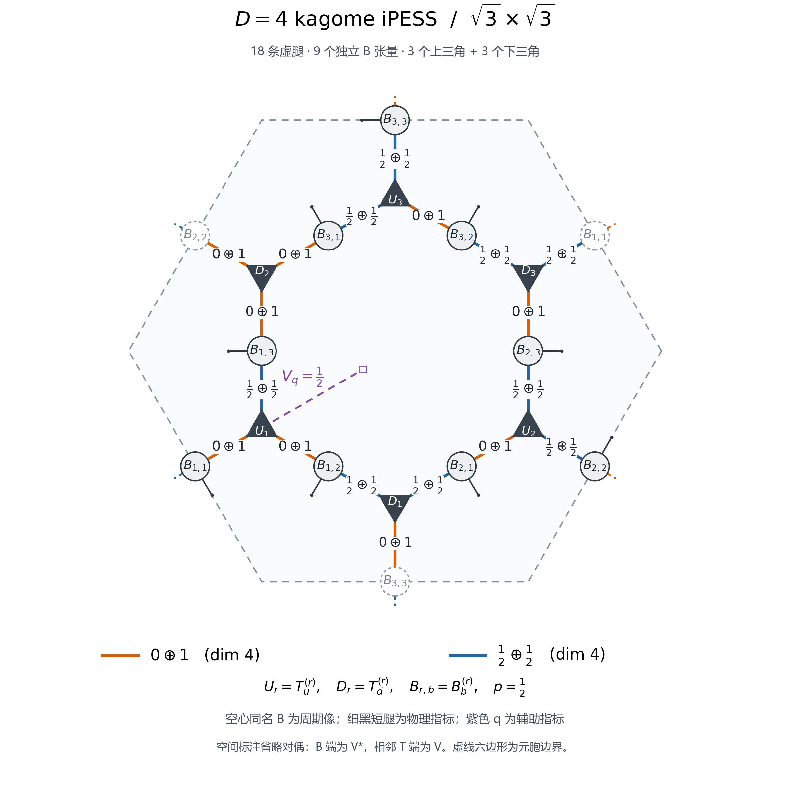

# Kagome sqrt3 iPESS virtual-space diagram

Open `draw_kagome_virtual_cell.py`, edit the settings at its top, and run the
whole file. No command-line arguments are needed. Dependencies are NumPy and
Matplotlib, with Python 3.11 or later for TOML input.

`d4_virtual_spaces.toml` is the nine-B virtual-space snapshot of the selected
D=4 SU2 state. Alternatively point `INPUT_FILE` at the full
`selected_su2_bond_ranks.toml` and set `STATE_KEY = "D4"` (or another state key).
Virtual-space labels and dimensions are read from the data, not hardcoded.
Adjust `OUTPUT_DIR`, `OUTPUT_NAME`, and `FULL_SPACE_LABELS` in the same section.

The plot shows a hexagonal Wigner-Seitz cell for translations (1,1),(-1,2),
with exactly three up and three down simplices. Nine B tensors are owned by
the cell; three hollow copies identify their periodic partners. Thus there
are nine independent physical spins, not twelve. There are eighteen internal
virtual-leg segments. Short dashed outward segments indicate continuation
through the boundary. Physical legs are drawn once, at the nine owned B's.

Conventions are the original Julia B(down,up,physical),
Tu(R)=[B1(R),B2(R),B3(R)],
Td(R)=[B1(R+ex),B2(R),B3(R+ey)], with r=1+mod(x-y,3).
For a compact spatial embedding, the U representatives are drawn at
(0,0),(1,0),(1,-1), periodic copies of stored representatives
(0,0),(1,0),(2,0). No virtual-leg indices are permuted.

SU2 dual marks are omitted from the representation labels: a B virtual leg
has the dual of its adjacent simplex's space. The auxiliary spin-1/2 is
attached to U1 and is not an extra physical Hamiltonian site.
The drawing retains its complete SU2 representation. The physical state
used for the quoted energy selects its auxiliary highest-weight component.

Geometry checks verify the node/edge counts, equal edge lengths and exact
periodic-image translations. Outputs are PNG and scalable SVG in `figures/`.
The fallback labels are English if the Windows Chinese font is unavailable.
